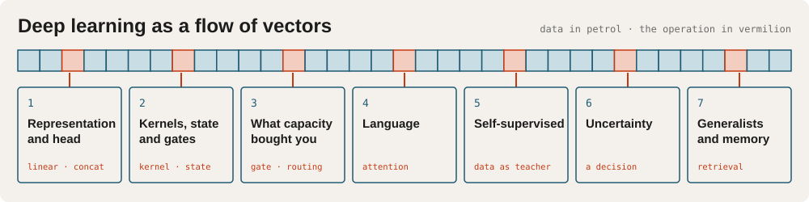

<p align="center">
  
</p>

<h1 align="center">MADS · Machine Learning</h1>

<p align="center"><b>Deep learning as a flow of vectors you design, search and defend</b></p>

<p align="center">
  <a href="#setup"><b>Set up</b></a> ·
  <a href="#the-lessons">Lessons</a> ·
  <a href="https://learn.pttrn.io">learn.pttrn.io</a> ·
  <a href="https://raoulg.github.io/MADS-MachineLearning-course/dav-recap.html">DAV recap</a> ·
  <a href="docs/submit-runs.md">Submit your runs</a>
</p>

<p align="center">
  
  <a href="https://docs.astral.sh/uv/"></a>
  <a href="https://github.com/raoulg/vectormesh"></a>
  <a href="https://github.com/raoulg/MADS-MachineLearning-course/actions/workflows/pages.yml"></a>
  <a href="#where-the-course-runs"></a>
</p>

A pretrained model has already ordered the vector space; you design what happens to those
vectors next. Each lesson adds one operation on the axes of a tensor, and each lesson ends in a
problem the class searches together: you publish your runs, look at the others', and the next
lesson opens on what the class found.

The course follows [MADS-DAV](https://github.com/raoulg/MADS-DAV) and assumes a decent basis in
Python. The book is [Understanding Deep Learning](https://udlbook.github.io/udlbook/), free as a
pdf and worth buying.

## The lessons

| | lesson | notebooks | learning goals |
|---|---|---|---|
| 1 | Representation and head | [`1_pytorch_intro`](notebooks/1_pytorch_intro) | [in pictures](https://raoulg.github.io/MADS-MachineLearning-course/leerdoelen-les1.html) · [text](references/leerdoelen/les1.md) |
| 2 | Kernels, state and gates | [`2_kernels_state_and_gates`](notebooks/2_kernels_state_and_gates) | [in pictures](https://raoulg.github.io/MADS-MachineLearning-course/leerdoelen-les2.html) · [text](references/leerdoelen/les2.md) |
| 3 | What did that capacity buy you | [`3_scaling_and_search`](notebooks/3_scaling_and_search) | [in pictures](https://raoulg.github.io/MADS-MachineLearning-course/leerdoelen-les3.html) · [text](references/leerdoelen/les3.md) |
| 4 | Language | [`4_language`](notebooks/4_language) | [in pictures](https://raoulg.github.io/MADS-MachineLearning-course/leerdoelen-les4.html) · [text](references/leerdoelen/les4.md) |
| 5 | Self-supervised learning | [`5_unsupervised`](notebooks/5_unsupervised) | [in pictures](https://raoulg.github.io/MADS-MachineLearning-course/leerdoelen-les5.html) · [text](references/leerdoelen/les5.md) |
| 6 | Uncertainty | [`6_uncertainty`](notebooks/6_uncertainty) | [in pictures](https://raoulg.github.io/MADS-MachineLearning-course/leerdoelen-les6.html) · [text](references/leerdoelen/les6.md) |
| 7 | Generalists and memory | [`7_generalists_and_memory`](notebooks/7_generalists_and_memory) | [in pictures](https://raoulg.github.io/MADS-MachineLearning-course/leerdoelen-les7.html) · [text](references/leerdoelen/les7.md) |

The learning goals are in Dutch, one picture per goal.

Handy to have open:

- [learn.pttrn.io](https://learn.pttrn.io): sign up for the `Machine Learning` course to see
  what to read and watch per lesson, and to tick off what you have done.
- [DAV recap](https://raoulg.github.io/MADS-MachineLearning-course/dav-recap.html): what this
  course takes for granted from Data Analysis & Visualisation.
- [Tensors, the slides of lesson 1](https://raoulg.github.io/MADS-MachineLearning-course/lesson1-tensors.html).
- [Submitting your runs](docs/submit-runs.md) to the class repository.
- [`0-baseline`](notebooks/0-baseline): check your Python and numpy before lesson 1.
- [`8_extras`](notebooks/8_extras): material that is good and not examined.

## How the repository is built

The project uses Python `>=3.12,<3.15` (`requires-python` in `pyproject.toml`), and all dependencies are defined within the `pyproject.toml` file.

The `.lefthook.yml` file is used by [lefthook](https://github.com/evilmartians/lefthook): before every commit it formats, lints and type-checks the code, clears notebook outputs and runs the staged notebooks. The setup below installs it for you, and explains each hook.

Data, representations and the training loop are separated out. You will find them as dependencies in the project:
- [huggingface `datasets`](https://huggingface.co/docs/datasets) — every dataset in the course is loaded from the hub with `load_dataset`. Nothing is downloaded by hand.
- https://github.com/raoulg/vectormesh — vectorizers, the `VectorCache` artefact format, the small shape-checked components you compose into a pipeline, and the `Trainer` that trains them

These will be used a lot in the notebooks; by separating them it is easier to use the code in your own repositories.

In addition to that, you can consider `vectormesh` as "extra material": if you are already more experienced in programming, `BaseVectorizer` and `VectorCache` are worth reading. They are short, and they are a good example of two ideas the course cares about — writing a tensor's shape into its type signature, and treating a computed artefact as a deliverable with a documented contract (`metadata.json`) rather than as a temp file.

In addition to that, there is a [codestyle repo](https://github.com/raoulg/codestyle) that covers most of the codestyle guidelines for the course. You will be expected to follow the codestyle guidelines for your own coding.

# Setup

The setup is meant to be done together with an assistant (Claude Code, Cursor, Codex). Hand it one of these URLs and ask it to walk you through; it takes one step at a time, explains why each tool is there, and keeps track of where you are between sessions.

Start with the local setup. If you did the setup of the DAV course, the guide first asks which topics you already have, so you only do what is left.

## local
The tools on the machine you write code on (git and GitHub, uv, an editor, the course repository, the pre-commit hooks, Atlas, the coaches, and the class runs repository):

```
https://raw.githubusercontent.com/raoulg/MADS-MachineLearning-course/master/references/tooling-setup.md
```

## VM (optional)
Most of you are better off on your own machine, which is usually faster than a VM. A VM is worth requesting when your laptop cannot run the course, for instance because it is managed by your organisation and does not let you install the tools. The lab guide covers requesting a VM and setting it up. Only if you already received a VM invitation by e-mail, do this guide first:

```
https://raw.githubusercontent.com/raoulg/MADS-MachineLearning-course/master/references/lab-setup.md
```

Two rules that matter from day one:

- **Work on your own branch, never on `master`**, and copy a notebook under a new name before editing it. `master` receives new material every week; a renamed file never conflicts with it.
- **Python and packages come from uv only.** No pip, no conda, no separately installed Python.

New to the tools? [uv projects](https://docs.astral.sh/uv/guides/projects/), a [git tutorial](https://www.w3schools.com/git/git_getstarted.asp), and the [command line for beginners](https://ubuntu.com/tutorials/command-line-for-beginners#1-overview).

## Where the course runs
The course is built to run on a laptop CPU: Linux, Windows (via git bash / WSL) and Apple Silicon (M-series) Macs with macOS 14 or newer (the torch wheel the course uses needs it; on an older macOS, update it or use a VM), on Python `>=3.12,<3.15`. A VM is optional: useful for a long training run that should not tie up your laptop, or when your laptop is old or short on memory.

**Intel Macs (x86_64) are not supported**: `torch` and `ray` publish no macOS x86_64 wheels for the versions the course uses. On an Intel Mac, use a VM and follow the VM guide above (`references/lab-setup.md`).