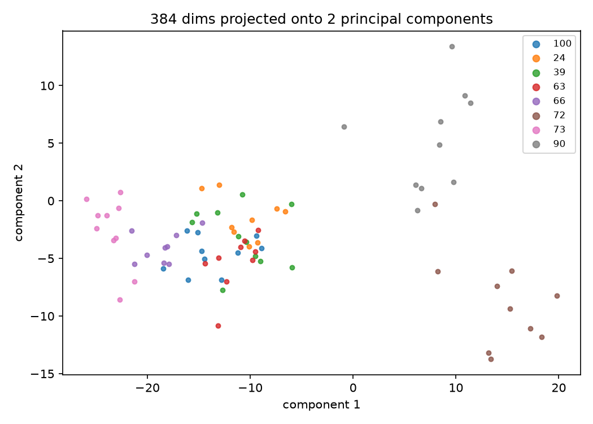

# A cache of flower vectors

Imagine comparing two flower photos. A foundation model can turn each photo into a list of numbers that captures visual features. You could run the model for every experiment, but the numbers would be the same each time. Here DINOv2 has already done that work. We start with its published vectors and ask what we can learn from them.

## 1. Where do the vectors come from?

Follow the first diagram from left to right. The Python script asks Hugging Face for `pttrn-io/oxford-flowers-dinov2-small`. `VectorCache.from_hub` opens the train or test split. The files contain an `embed` column, a `label` column and metadata describing the classes. `load_vectors` hands those values to `Vectors`.

<atlas-view ref="views/01_cache_route.json" at="notebooks.1_pytorch_intro.01_the_cache_demo.load_vectors" title="From Hugging Face to a tensor of vectors" source="01_the_cache_demo.py" />

A **vector** is one row of 384 numbers. It represents one image, but it is not the image itself. The train split holds 4,000 rows, so its `embed` value is a rank-2 tensor of shape `(4000, 384)`. The labels form a rank-1 tensor of shape `(4000)`: one class ID per row. The test split has another 1,000 rows.

The `load_vectors` frame shows the function that reads the cache. Drag the diagram to the right to bring the Hugging Face and file boxes into view: those are the places where the data rests. Hover over `VectorCache.from_hub` and press **Space** to see its Python code. Open **Full view** for the entire script route.

## 2. How can a cache make a prediction?

There is no training step in this demonstration. For each test flower, we find the most similar training flower and copy its label. `OneNearestNeighbour.predict` performs the lookup.

<atlas-view ref="views/01_predict.json" at="notebooks.1_pytorch_intro.01_the_cache_demo.OneNearestNeighbour.predict" title="One test vector becomes a flower label" source="01_the_cache_demo.py" />

`cosine_similarity` first scales every vector to length one. The dot product then measures how closely two vectors point in the same direction: `1` means the same direction, `0` means perpendicular. Comparing 1,000 test vectors with 4,000 training vectors makes a rank-2 similarity tensor of shape `(1000, 4000)`.

Each row of that tensor belongs to one test flower. `argmax` finds the column with the highest similarity. That column is a training row; indexing `train.labels` gives us its flower class. The final prediction is a rank-1 tensor of 1,000 labels. Press **Space** over `cosine_similarity` or `argmax` to follow the code behind a step.

## 3. Can we see what the encoder learned?

The script projects a selection of those 384-dimensional vectors onto two PCA axes. Nearby points in this picture had related representations before a classifier saw them. The plot is a projection for inspection, not the data used for the nearest-neighbour calculation.

Use **Run script** to update the picture and read the measurements in Studio's terminal. On the published cache, the one-nearest-neighbour accuracy is `0.9910`; random guessing among 102 classes is about `0.0098`. What is doing most of the work here: the nearest-neighbour rule, or the representation produced by DINOv2?
