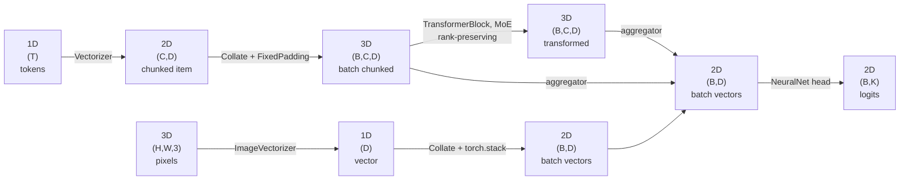

# Shape and meaning: the tensor ladder

Shared notation for the whole course. Introduced in `01_the_cache.ipynb` §1.3; every lesson after
that **refers** to this page instead of re-explaining it.

The single most useful idea here is that tensors live on **two levels at once**, and that almost
every confusion about "can I use model X on data Y" comes from mixing them up.

---

## 1. Two levels

**Formal level — a tensor is a rank and a shape. That is all.**

`(200, 3)` is a 2D tensor with 200 rows of 3 numbers. `torch` knows nothing else about it, and
every operation you will ever call sees only this. A 2D tensor is a 2D tensor.

**Semantic level — what the axes stand for.** That same `(200, 3)` could be:

- 200 timesteps of a 3-sensor signal,
- a batch of 200 items, each a 3-dimensional vector,
- one document chunked into 200 pieces with 3 features each,
- 200 RGB pixels,
- a 200x3 greyscale image.

These are **the same tensor**. Nothing in the object distinguishes them. The meaning lives in your
head, in the variable name, and — if you are being careful — in a type annotation.

So there are two different questions, and they have two different answers:

| Question | Level | Who answers it |
|---|---|---|
| *Will this run?* | formal | the shape rules, mechanically |
| *Does the result mean anything?* | semantic | only you |

Keep them apart and a lot of things get simpler.

## 2. "Can you use a CNN on a timeseries?"

Ask a group of students this and most say no: a CNN is an image model, and a timeseries is not an
image.

That is a *semantic* answer to a *formal* question, and it is wrong.

Formally, `nn.Conv1d` requires `(B, C, L)` — batch, channels, length. A batch of timeseries with
`S` timesteps and `D` sensors is `(B, S, D)`. One `permute` and it is `(B, D, S)`: `C = D` sensors,
`L = S` steps. It fits. That *is* what "a 1d CNN on timeseries" means — there is no separate
architecture, it is the same operation with the axes lined up differently.

And `nn.Conv2d` requires `(B, C, H, W)`. Take the same `(B, S, D)` batch, `unsqueeze(1)`, and you
have `(B, 1, S, D)`: a one-channel "image" whose height is time and whose width is sensors. Conv2d
will not complain. It will train. It is a real technique.

```python
x = torch.rand(32, 200, 3)               # (B, S, D): 32 series, 200 steps, 3 sensors
nn.Conv1d(3, 16, kernel_size=5)(x.permute(0, 2, 1)).shape   # (32, 16, 196)
nn.Conv2d(1, 16, kernel_size=3)(x.unsqueeze(1)).shape       # (32, 16, 198, 1)
```

That `unsqueeze(1)` is free. An axis of length 1 adds an index that can only be 0, and moves
no number: a grey image `(H, W)` is the same data as a one-channel image `(1, H, W)`, one
chunked document `(C, D)` is a batch of one `(1, C, D)`, and a batch `(B, D)` is `B` documents
of one chunk each, `(B, 1, D)`. `squeeze(dim)` takes the axis away again. Name the `dim`:
a bare `squeeze()` removes every axis of length 1, including a batch axis that happens to
hold one item. Notebook 01b draws it.

"CNN = image model" is a habit of association, not a constraint. The formal constraint is only
"rank 3, channels second" or "rank 4, channels second".

Which frees you up to ask the question that actually matters: **does convolving along this axis
exploit real structure?** A convolution assumes locality (nearby positions are related) and
translation invariance (the same pattern means the same thing wherever it occurs). Time has both,
which is why 1d CNNs on signals work well. The *sensor* axis usually has neither — sensor 1 and
sensor 2 are not "near" each other in any meaningful sense — which is a good reason to make sensors
the channel axis rather than a spatial one.

That is a real, arguable, empirical question. "Is it allowed" was never the interesting part.

## 3. The formal level: what the common layers require

| Layer | Wants | Notes |
|---|---|---|
| `nn.Linear(D, K)` | `(..., D)` | acts on the **last** axis, accepts *any* leading shape |
| `nn.Conv1d(C, ...)` | `(B, C, L)` | channels second |
| `nn.Conv2d(C, ...)` | `(B, C, H, W)` | channels second |
| `nn.GRU/LSTM/RNN` | `(B, S, D)` | with `batch_first=True`, else `(S, B, D)` |
| attention, `TransformerBlock` | `(B, S, D)` | `S` is whatever you are attending over |
| `nn.CrossEntropyLoss` | `(B, K)` and `(B,)` | logits and integer targets |

Read that first row again, because it is the one that bites: **`nn.Linear` accepts any leading
shape.** It will never tell you that you handed it a batch of chunked documents when you meant a
batch of documents.

## 4. The semantic level: this course's vocabulary

When we *do* talk about meaning, we use these letters consistently:

`B` batch · `C` chunks · `D` feature dimension · `S` timesteps · `T` tokens · `K` classes ·
`H`, `W` spatial

and these four rungs come up constantly, because they are the shapes a cached-vector pipeline moves
through:

| Rank | Shape | Name | What it is |
|:---:|---|---|---|
| 1D | `(D)` | **vector** | one item, one representation |
| 2D | `(C, D)` | **chunked item** | one item, split into `C` chunks |
| 2D | `(B, D)` | **batch of vectors** | after collation, or after aggregation |
| 3D | `(B, C, D)` | **batch of chunked items** | after collation with a padder |

**`(C, D)` and `(B, D)` are formally identical.** Both are just 2D tensors; no operation can tell
them apart, and neither can you by looking at the object. The difference is entirely semantic:
`(C, D)` is one document, `(B, D)` is a batch of documents. Which one you are holding depends only
on whether you are before or after collation.

This is not a flaw in the notation — it is the notation being honest about a real ambiguity. The
practical consequence is that you have to *track* it: know where in the pipeline you are, and say
it out loud in variable names and annotations. A cache's `metadata.json` records it for you in the
`tensordtype` field.

## 5. The flow



| From | To | Operation |
|---|---|---|
| `(T)` tokens | `(C, D)` | `Vectorizer` — tokenize with overflow, embed, mean-pool per chunk |
| `(H, W, 3)` pixels | `(D)` | `ImageVectorizer` — a frozen vision encoder |
| raw text | `(D)` | `RegexVectorizer` — hand-designed binary features |
| `(D)` | `(B, D)` | `Collate(padder=torch.stack)` |
| `(C, D)` | `(B, C, D)` | `Collate(padder=FixedPadding(...))` or `DynamicPadding()` |
| `(B, C, D)` | `(B, C, D)` | `TransformerBlock`, `MoE`, `Projection` — rank-preserving |
| `(B, C, D)` | `(B, D)` | any aggregator — `MeanAggregator`, `MaskedMeanAggregator`, `AttentionAggregator` |
| `(B, D)` | `(B, K)` | `NeuralNet` head |

Two things worth saying out loud:

- **The modalities converge at `(B, D)`.** An image cache, a regex cache and a text cache reuse the
  same `Collate` and the same head, because at the formal level there is nothing left to
  distinguish them. The chunked lane just has one extra rung to climb down.
- **Aggregation is the only rank-reducing step.** So *where do I aggregate?* is the single most
  consequential structural decision in a pipeline: fuse before it and you fuse per chunk, fuse after
  and you fuse per document.

## 6. Where the silence bites

`nn.Linear` acts on the last axis and accepts any leading shape:

```python
layer = torch.nn.Linear(384, 2)
layer(torch.rand(32, 384)).shape       # (32, 2)     -- (B, D) -> (B, K),  what you meant
layer(torch.rand(32, 7, 384)).shape    # (32, 7, 2)  -- (B, C, D) -> (B, C, K),  no error
```

The second call is formally fine and semantically a bug: you now have a prediction *per chunk*
instead of per document. The model will train. The loss will go down. Nothing raises.

Compare that with §2. There, the formal level being permissive was liberating — it let a CNN eat a
timeseries. Here the same permissiveness hides a mistake. **It is the same property both times.**
The difference is whether you meant it.

## 7. Contracts write the semantic level into the code

`jaxtyping` + `beartype` let you state the rung in the signature and have it checked at runtime.
The annotation `Float[Tensor, "batch dim"]` *is* the `(B, D)` from the table — a semantic claim,
enforced formally.

```python
from beartype import beartype
from jaxtyping import Float, jaxtyped

@jaxtyped(typechecker=beartype)
def head(x: Float[Tensor, "batch dim"]) -> Float[Tensor, "batch classes"]:
    return layer(x)

head(torch.rand(32, 7, 384))
# jaxtyping.TypeCheckError:
#   Actual value: f32[32,7,384](torch)
#   Expected type: Float[Tensor, 'batch dim']
```

The names in the annotation are yours to choose — `"batch steps sensors"`, `"batch chunks dim"`,
whatever the tensor actually is. jaxtyping also checks that repeated names agree across arguments,
so `"batch dim"` and `"batch classes"` pin the two tensors to the same batch size.

So a `TypeCheckError` is not noise. It is the only mechanism that turns a semantic mistake into a
formal one, which is the only kind the computer can catch for you.

## 8. Reading a cache before writing model code

`metadata.json` is the public API of a dataset, and it is where the semantic level is written down
for a cache you did not build.

| field | tells you |
|---|---|
| `<col>.hidden_size` | the `D` in every shape above |
| `<col>.tensordtype` | the rank of one item: `1` is `(D)`, `2` is `(C, D)` |
| `<col>.chunk_sizes` | how big `C` gets, and how often — the histogram that sets `max_chunks` |
| `<col>.model_tag` | which encoder produced the vectors |
| `num_observations` | how many rows |
| `features` | which columns are in the cache at all |

`<col>` is the embedding column — `embed`, `regex_features`, whatever the vectorizer wrote. A cache
can hold several, which is how one item ends up with several representations.

Worked example, from the IMDB granite cache:

```json
"embed": {"hidden_size": 384, "tensordtype": 2,
          "chunk_sizes": {"1": 21501, "2": 2879, "3": 587, "4": 26, "5": 5, "6": 1, "8": 1}}
```

`tensordtype: 2` says one item is `(C, D)`, so batching needs a padder and a batch is
`(B, C, 384)` — which means a head alone will not do, there has to be an aggregator first. And
`chunk_sizes` says 86% of documents are a single chunk, so `max_chunks=2` truncates almost nothing
while `max_chunks=8` would spend most of its compute on zeros.

You can state all of that before running a single line.
